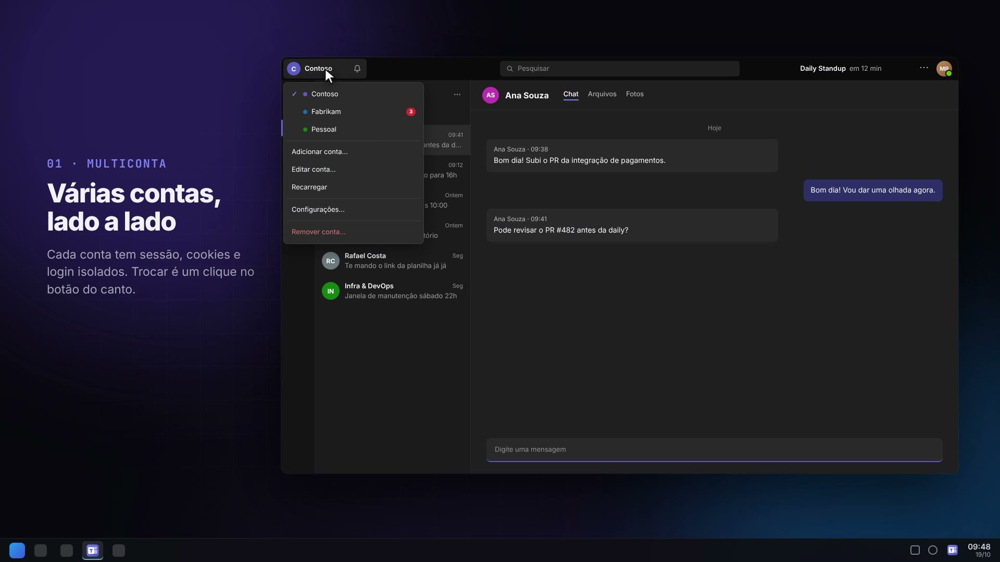
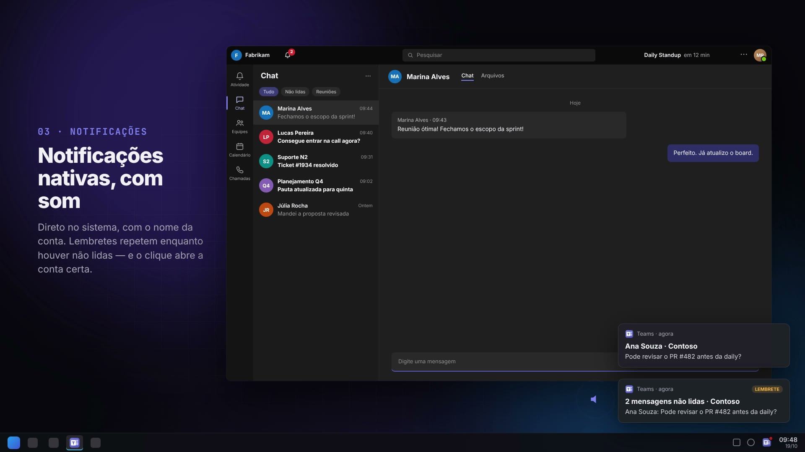
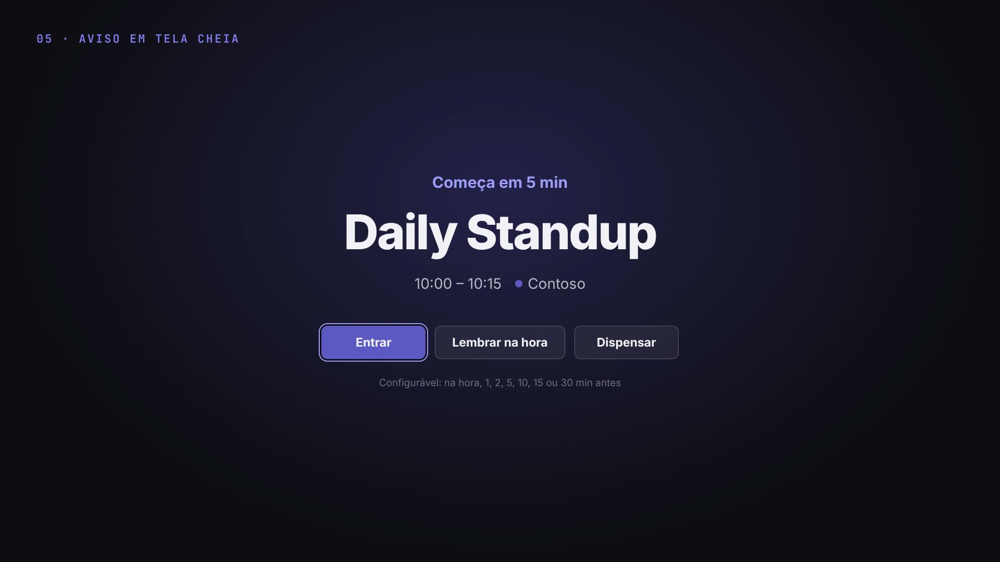

<div align="center">


# Teams para Linux

**Microsoft Teams com várias contas, notificações nativas e avisos de reunião — num app de verdade para Linux.**

Electron · Wayland · KDE Plasma · Arch / pacman

[](docs/teams-linux.mp4)

<sub>▶ Clique na imagem para ver o vídeo de apresentação (1 min).</sub>

</div>

---

## Por quê

A Microsoft não tem um cliente do Teams para Linux. No navegador dá para usar, mas é uma conta por vez, a aba se perde entre as outras e as notificações aparecem quando querem. Quem trabalha com mais de um tenant (cliente, empresa, conta pessoal) acaba alternando entre perfis do navegador o dia inteiro.

Este app resolve isso: cada conta vive isolada dentro de uma única janela, com troca em um clique, notificações do sistema e a agenda à vista.

## Funcionalidades

| | |
|---|---|
| **Várias contas, isoladas** | Cada conta tem sessão, cookies e login próprios (`persist:account-<id>`). Contas de trabalho/escola e pessoais. |
| **Botão de contas no canto** | Fica no lugar do lançador de apps do Teams. Mostra a conta ativa e um sino com as não lidas das *outras* contas. |
| **Notificações nativas, com som** | Vão direto para o sistema (libnotify/KDE), com o nome da conta. Clicar abre a janela na conta e na conversa certas. |
| **Lembretes de não lidas** | Opcional: repete a notificação a cada N segundos enquanto houver mensagens não lidas. |
| **Próxima reunião no cabeçalho** | "Daily Standup em 12 min", lido da agenda de todas as contas, com destaque quando está perto. |
| **Aviso em tela cheia** | Antes de cada reunião (na hora, 1, 2, 5, 10, 15 ou 30 min antes), com *Entrar*, *Lembrar na hora* e *Dispensar*. Inspirado no [Dato](https://sindresorhus.com/dato). |
| **Nenhuma conta dormindo** | Na abertura, cada conta carrega por inteiro, inclusive as que ficam em segundo plano — senão o Teams delas não termina de iniciar e as notificações não chegam. |
| **Chamadas e tela compartilhada** | Chromium completo (WebRTC); no Wayland o compartilhamento usa o seletor do sistema (portal). |
| **Bandeja do sistema** | Fechar só esconde a janela; o ícone da bandeja ganha um ponto vermelho com não lidas. |
| **Detalhes** | Instância única, posição da janela lembrada, downloads direto em `~/Downloads` com aviso, links externos no navegador padrão. |

<table>
  <tr>
    <td></td>
    <td></td>
  </tr>
  <tr>
    <td></td>
    <td></td>
  </tr>
</table>

<sub>Imagens do vídeo de apresentação, com contas e conversas fictícias.</sub>

## Instalação (Arch, CachyOS, Manjaro…)

Requer [bun](https://bun.sh).

```sh
git clone https://github.com/dilincoln/teams-linux.git
cd teams-linux/electron
bun install
bun node_modules/electron/install.js   # baixa o binário do Electron (o bun bloqueia o postinstall)
bun run build                          # gera dist/teams-linux-<versão>.pacman
sudo pacman -U dist/teams-linux-*.pacman
```

Depois é só abrir **Teams** pelo menu. Para desinstalar: `sudo pacman -R teams-linux`.

Iniciar já escondido na bandeja (por exemplo, no início da sessão): `teams-linux --minimized`.

### Rodar sem instalar

```sh
cd electron
bun install && bun node_modules/electron/install.js
bun run start
./install-desktop.sh   # opcional: atalho no menu apontando para esta pasta
```

## Configurações

No botão de contas → **Configurações…**

- **Lembrete de não lidas** — intervalo em segundos (0 desliga; mínimo 10).
- **Som nas notificações** — liga/desliga e escolhe entre os sons do sistema (Ocean, Freedesktop), com botão para ouvir.
- **Aviso em tela cheia** — antecedência do aviso de reunião, com botão para testar.
- **Próxima reunião no cabeçalho** — mostra ou esconde.

Tudo fica em `~/.config/Teams/config.json`.

## Como funciona

```
BaseWindow (sem moldura)
├── WebContentsView por conta   → sessão própria (partition), preload-account.cjs
└── WebContentsView local       → dropdown, diálogos e tela de carregamento (ui/)
BrowserWindow em tela cheia     → aviso de reunião (ui/alert.*)
```

- **Notificações:** o preload troca `window.Notification` (e `showNotification` do service worker) por uma versão que passa pelo processo principal, que mostra a notificação nativa, toca o som e sabe de qual conta ela veio.
- **Botão de contas e próxima reunião:** elementos injetados no cabeçalho do Teams; o CSS esconde os botões originais daquele canto e transforma o cabeçalho em área de arrastar (a janela não tem moldura).
- **Não lidas:** vêm do título da página (`(3) Chat | Microsoft Teams`).
- **Agenda:** o Teams já guarda, para cada conta, um token do Microsoft Graph com permissão de leitura da agenda. O app usa esse token para consultar `/me/calendarView` a cada 5 minutos — sem login extra. Nada sai da máquina além das chamadas ao próprio `graph.microsoft.com`.
- **Contas em segundo plano:** uma `WebContentsView` escondida não renderiza, e o Teams fica preso na tela de abertura. Na inicialização cada conta fica visível (atrás da tela de carregamento) até o Teams terminar de montar; se uma conta recarregar depois, ela é "reaquecida" atrás da conta ativa, sem o usuário perceber.
- **User-Agent:** sem `Electron/x`, para o Teams tratar como Chrome comum.

### Estrutura

```
electron/          o app
  main.js          processo principal: janela, contas, bandeja, notificações, agenda, avisos
  preload-*.cjs    pontes de cada página (contas, UI local, aviso de reunião)
  ui/              dropdown, diálogos, carregamento e aviso em tela cheia
video/             vídeo de apresentação (HyperFrames)
docs/              vídeo renderizado e imagens deste README
```

## Vídeo

O vídeo de apresentação é uma composição HTML + GSAP feita com [HyperFrames](https://hyperframes.heygen.com), com mocks do app (contas e pessoas fictícias). Para renderizar de novo:

```sh
cd video
bunx hyperframes preview                                  # editar / assistir
bunx hyperframes render --output renders/teams-linux.mp4  # MP4 1080p
```

Trilha sonora: vídeo do [M-Atende](https://mutualtecnologia.com.br), da Mutual Tecnologia.

## Aviso

Projeto pessoal, sem vínculo com a Microsoft. Microsoft Teams é marca registrada da Microsoft Corporation. O app apenas carrega o Teams web oficial (`teams.microsoft.com` / `teams.live.com`).

## Licença

[MIT](LICENSE)
