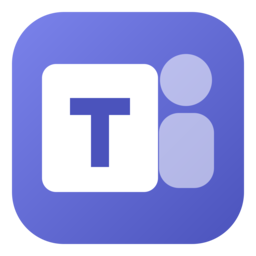
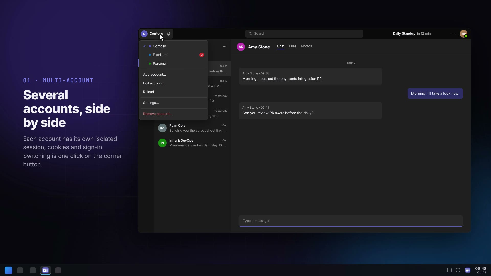
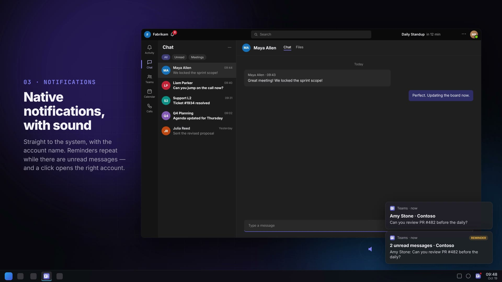
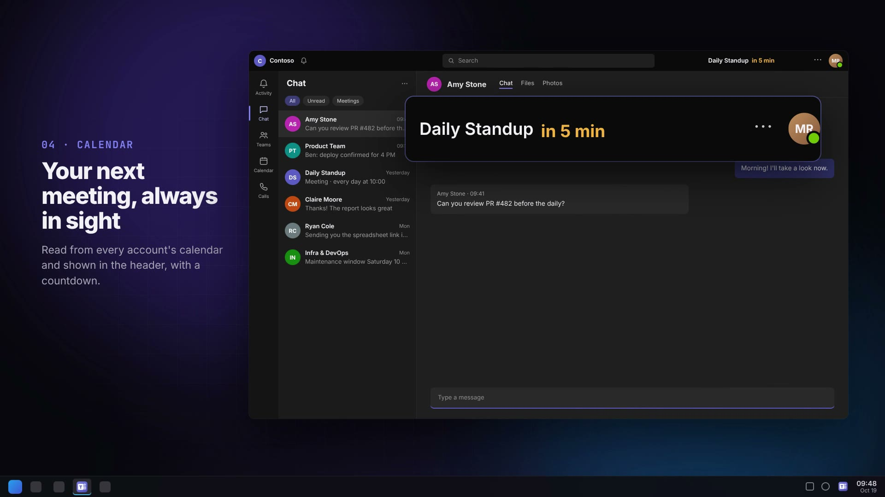
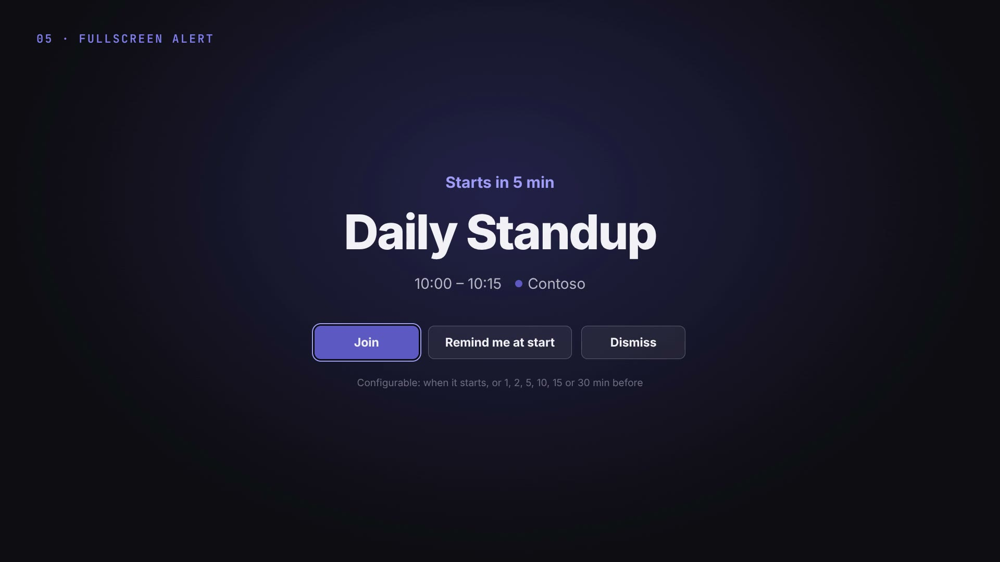

<div align="center">



# Teams for Linux

**Microsoft Teams with multiple accounts, native notifications and meeting alerts — in a real Linux desktop app.**

Electron · Wayland · KDE Plasma · Arch / pacman

</div>

<div align="center">

[](docs/teams-linux.mp4)

</div>

---

## Why

Microsoft doesn't ship a Teams client for Linux. The web version works in a browser, but only one account at a time, the tab gets lost among the others and notifications show up whenever they feel like it. If you work across more than one tenant (a client, your company, a personal account), you end up juggling browser profiles all day.

This app fixes that: every account lives isolated inside a single window, one click away, with system notifications and your calendar in sight.

## Features

| | |
|---|---|
| **Multiple isolated accounts** | Each account has its own session, cookies and sign-in (`persist:account-<id>`). Work/school and personal accounts. |
| **Account button in the corner** | Sits where the Teams app launcher used to be. Shows the active account and a bell with the unread count of the *other* accounts. |
| **Native notifications, with sound** | Sent straight to the system (libnotify/KDE), tagged with the account name. Clicking one opens the window on the right account and conversation. |
| **Unread reminders** | Optional: repeats the notification every N seconds while there are unread messages. |
| **Next meeting in the header** | "Daily Standup in 12 min", read from every account's calendar, highlighted when it's close. |
| **Fullscreen alert** | Before each meeting (when it starts, or 1, 2, 5, 10, 15 or 30 min before), with *Join*, *Remind me at start* and *Dismiss*. Inspired by [Dato](https://sindresorhus.com/dato). |
| **No account left asleep** | At startup every account loads all the way, including the ones in the background — otherwise their Teams never finishes booting and notifications never arrive. |
| **Calls and screen sharing** | Full Chromium (WebRTC); on Wayland, screen sharing uses the system picker (portal). |
| **System tray** | Closing only hides the window; the tray icon gets a red dot when there are unread messages. |
| **Details** | Single instance, remembered window position, downloads straight to `~/Downloads` with a notice, external links in the default browser. |

<table>
  <tr>
    <td></td>
    <td></td>
  </tr>
  <tr>
    <td></td>
    <td></td>
  </tr>
</table>

<sub>Frames from the showcase video, with fictional accounts and conversations.</sub>

## Installation (Arch, CachyOS, Manjaro…)

Requires [bun](https://bun.sh).

```sh
git clone https://github.com/dilincoln/teams-linux.git
cd teams-linux/electron
bun install
bun node_modules/electron/install.js   # downloads the Electron binary (bun blocks postinstall)
bun run build                          # produces dist/teams-linux-<version>.pacman
sudo pacman -U dist/teams-linux-*.pacman
```

Then open **Teams** from the app menu. To uninstall: `sudo pacman -R teams-linux`.

To start hidden in the tray (e.g. on login): `teams-linux --minimized`.

### Run without installing

```sh
cd electron
bun install && bun node_modules/electron/install.js
bun run start
./install-desktop.sh   # optional: app menu launcher pointing to this folder
```

## Settings

Account button → **Settings…**

- **Unread reminder** — interval in seconds (0 turns it off; minimum 10).
- **Play a sound with notifications** — on/off, plus a choice of system sounds (Ocean, Freedesktop) with a preview button.
- **Fullscreen alert before meetings** — how early the meeting alert shows up, with a test button.
- **Show the next meeting in the header** — show or hide it.

Everything is stored in `~/.config/Teams/config.json`.

## How it works

```
BaseWindow (frameless)
├── WebContentsView per account   → own session (partition), preload-account.cjs
└── local WebContentsView         → dropdown, dialogs and loading screen (ui/)
fullscreen BrowserWindow          → meeting alert (ui/alert.*)
```

- **Notifications:** the preload swaps `window.Notification` (and the service worker's `showNotification`) for a version that goes through the main process, which shows the native notification, plays the sound and knows which account it came from.
- **Account button and next meeting:** elements injected into the Teams header; CSS hides the original buttons in that corner and turns the header into the drag area (the window is frameless).
- **Unread count:** taken from the page title (`(3) Chat | Microsoft Teams`).
- **Calendar:** Teams already keeps, for each account, a Microsoft Graph token allowed to read the calendar. The app uses that token to query `/me/calendarView` every 5 minutes — no extra sign-in. Nothing leaves the machine except the calls to `graph.microsoft.com` itself.
- **Background accounts:** a hidden `WebContentsView` doesn't render, and Teams gets stuck on its splash screen. At startup each account stays visible (behind the loading screen) until Teams finishes mounting; if an account reloads later, it is "warmed up" again behind the active account, without the user noticing.
- **User-Agent:** without `Electron/x`, so Teams treats it as regular Chrome.

### Layout

```
electron/          the app
  main.js          main process: window, accounts, tray, notifications, calendar, alerts
  preload-*.cjs    bridges for each page (accounts, local UI, meeting alert)
  ui/              dropdown, dialogs, loading screen and fullscreen alert
video/             showcase video (HyperFrames)
docs/              rendered video and the images in this README
```

## Video

The showcase video is an HTML + GSAP composition made with [HyperFrames](https://hyperframes.heygen.com), using mocks of the app (fictional accounts and people). To render it again:

```sh
cd video
bunx hyperframes preview                                  # edit / watch
bunx hyperframes render --output renders/teams-linux.mp4  # 1080p MP4
```

Soundtrack: from the [M-Atende](https://mutualtecnologia.com.br) video, by Mutual Tecnologia.

## Disclaimer

Personal project, not affiliated with Microsoft. Microsoft Teams is a trademark of Microsoft Corporation. The app only loads the official Teams web app (`teams.microsoft.com` / `teams.live.com`).

## License

[MIT](LICENSE)
